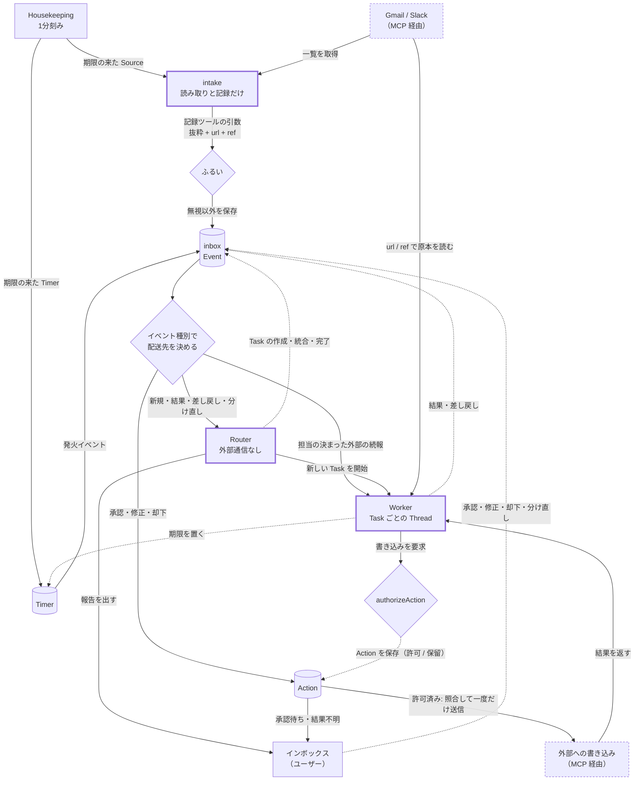

# Always-on エージェント

対象: macOS の内蔵 Pi。Local Account / Server Account 共通。Private Web / Electron は内蔵 Pi がないため対象外。
状態: 段階0〜2を実装・自動検証済み（[仕様](../spec/desktop/always-on-agent.md) は 2026-11-19 にユーザー承認済み、[段階0の結果](#段階0の結果)）。実アプリでの設定画面の確認と、実際の Source での取り込みのトークン量の計測が残る。段階3以降は [Dahlia Bot（AI 秘書）](2026-11-23-dahlia-bot-secretary.md)に移した。
前提: アプリ起動中だけ動く。常駐 daemon とクラウド実行は作らない。

この計画は、[定期エージェントの仕様](../spec/desktop/scheduled-agent-scope.md) と PRODUCT.md の T4 が禁じていた
「外部への書き込み」を含む。それを認める [仕様](../spec/desktop/always-on-agent.md) は承認済みで、PRODUCT.md と定期エージェントの仕様 も更新した。

## 目的

Gmail や Slack を見回る役をユーザーから外す。対応が必要なものだけが提案つきで届き、任せた範囲は自動で片付く。
承認・修正・却下の履歴から、任せる範囲の昇格を仕組みが提案する。

## 用語

| 名前 | 役割 | テーブル |
| --- | --- | --- |
| Source（接続元） | 何をどの間隔で読むか。MCP server、指示文、取り込み位置、ふるいの設定を持つ | `agent_event_sources` |
| Event（イベント） | inbox の1行。外部の事象、ワーカーの結果、ユーザーの操作、タイマーの発火 | `agent_event_inbox` |
| Topic（会話） | 外部の1つの会話の流れ（メールスレッド、Slack スレッド）。担当 Task を1つ持つ | `agent_event_topics` |
| Task（案件） | 作業単位。作業 Thread を1本持ち、1つ以上の Topic を担当する | `agent_tasks` |
| Action（アクション） | 外部への書き込み1回。Worker が選んだ tool 呼び出しで、版、接続先と実行主体、確定した引数、状態を持つ | `agent_action_outbox` |
| Policy（任せる範囲） | tool と引数の条件に対する自動化レベル | `agent_action_policies` |
| Timer（タイマー） | ワーカーが置く期限と、繰り返しの予定 | `agent_timers` |
| 全停止 | アカウントごとの停止スイッチ | `agent_always_on_settings` |
| Router | 新しいイベントを Task に割り当てる LLM 実行。外部通信を持たない | — |
| Worker | Task を実行する LLM 実行。原本を読み、書き込みを選び、結果を見て次を決める | — |
| インボックス | ユーザーに見せる Item の一覧（[Dahlia Bot](2026-11-23-dahlia-bot-secretary.md#item)） | `agent_user_inbox`（未実装） |

Dahlia の Thread（AI との会話）と混同しないよう、外部の会話の流れは Topic と呼ぶ。
Event は取り込んだ事象で、カレンダーの予定（`calendar_event_sources` などの event）ではない。
Swift の型名は1行を表す名前（`AgentEventRecord`、`AgentActionRecord`）のまま、テーブル名だけを入れ物の名前にしている。

## 流れ



太枠は LLM 実行（内蔵 Pi）、破線の枠は外部サービス、それ以外はネイティブ側のコードとユーザー。点線の矢印は inbox、Timer、Action への書き込みを示す。

Housekeeping の各処理と、主体ごとの役割は次のとおり。

```
Housekeeping（1分刻み）
 ├ intake : 期限の来た Source ごとに取り込み実行を積む
 ├ timers : 期限の来た Timer をイベントとして inbox に追加する
 ├ route  : イベント種別で配送先を決める。担当の決まった外部の続報は Worker へ、
 │          承認・修正・却下は対象の Action へ、残りは Router 実行を1本積んで渡す
 ├ watch  : 動きのない実行、失敗を繰り返す Task と Source を止めて知らせる
 └ review : 週1回、Policy の昇格候補を SQL で集計して知らせる

intake → MCP で読み、記録ツールに引数を入れる → コードがふるいにかけて Event を追加（抜粋 + url + ref）
Router → イベントだけを見て Task を作成・統合・却下・完了
Worker → Task の指示と url / ref から原本を読み、作業する
          書き込みは Action として保存し、authorizeAction が 許可・保留・拒否 を決める
          許可された Action は照合のうえ一度だけ送信し、結果を Worker に返す
          終了時に結果イベントを追加する
ユーザー → 承認・修正・却下・分け直しは操作イベントとして追加する
```

## 決まり

### inbox

- inbox が正本。1アカウントに1つ。Source は実行を直接始めず、イベントを追加するだけにする。
- 重複排除は `(accountID, sourceID, externalID)` の一意キーで行う。
- イベントは外部 ID、送信者、件名、短い抜粋、`url`（原本のパーマリンク）、`ref`（MCP で読み直すための ID）を持つ。本文は保存しない。
- intake、Worker、ユーザー、Timer はイベントの追加だけを行う。
- 割り当てを決めるのは Router だけ。割り当て・配送・処理の状態を永続化するのはネイティブ側だけ。

### 取り込み位置

- 取得範囲とページ送りはコードが管理する。LLM に位置を決めさせない。
- intake の実行が使えるのは、許可済みの読み取り tool と記録ツールだけにする。Pi が MCP の結果から、記録ツールの引数（外部 ID、Topic のキー、送信者、件名、抜粋、`url`、`ref`、発生時刻）を埋める。MCP ごとの結果の形の違いは Pi が吸収し、Source を足すときにコードを増やさない。
- 読み落としは、Pi の `tool_result` フックで検出する。結果が項目を列挙する場合（初期版は Gmail の `items[]` のうち `id` と `threadId` を持つもの）、ID の一覧をコードが控え、全件が「保存した」か「設定どおり無視した」になるまで位置を進めない。
- 項目を列挙しない Source（Slack など）は、照合なしで位置を進める。設定画面は、照合するのが Gmail だけであることを示す。
- 記録ツールが受け付けなかった呼び出しや、記録されなかった項目がある実行が3回続いたら、位置を進め、その Source に「欠落の可能性」を表示する。ユーザーは表示を確認済みにできる。
- 途中で失敗した取り込みは位置を進めず、次回に同じ範囲を読み直す。モデルのエラーや中断で終わった実行、記録ツールが受け付けなかった呼び出しを含む実行も失敗とする。
- 初期版の位置は、前回成功した取り込みの開始時刻とし、Pi にはその時刻以降を読ませる。ページ送りは Pi が行う。照合の取り出し方を Source が持てるようになったら、上の照合で補う。
- 差分の履歴が失効した、または上限を超えて追いつけない場合は、再同期し、その Source に「欠落の可能性」を表示する。

### イベントの配送

イベントは「未割り当て → 割り当て済み → 配送済み → 処理済み」と進む。「配送した」と「処理した」を区別する。

配送先は、最初にイベントの種別で決める。Topic による直接配送は外部の続報だけに使う。

| イベントの種別 | 配送先 |
| --- | --- |
| 外部の事象（担当 Task のない Topic） | Router |
| 外部の続報（担当 Task が進行中の Topic） | 担当 Worker。Router は通さない |
| Worker の結果、差し戻し | Router。Worker が自分の結果で再起動しないようにする |
| ユーザーの承認・修正・却下 | 対象の Action |
| ユーザーの分け直し | Router |
| Timer の発火 | 置いた Task が進行中ならその Worker、そうでなければ Router |

- 処理完了を保存していないイベントは、再起動後の再開対象にする。受け取る前に落ちた場合も、受け取った後で処理済みになる前に落ちた場合も、同じ Worker に配送し直す。
- 完了済みの Task に届いた続報と、Worker が差し戻したイベントは、未割り当てに戻して Router に渡す。同じ相手に送り続けない。
- 続報は文脈を足すだけで、権限を増やさない（[Worker](#worker)）。

### Router

- MCP、ネットワーク、ファイル、bash を持たない。使えるのは inbox と Task を読む tool と、Task の作成・イベントの追加・却下・完了の tool だけ。
- アカウントごとに同時1本。未処理イベントがあるときだけ動き、溜まったイベントをまとめて処理する。
- 毎回新しいセッションで起動する。状態はテーブルとメモリーから読む。
- 毎回読むメモリーは、ユーザーの指示、学んだ好み、進行中の Task の索引、既に報告した内容の4つ。読み直せるものは参照だけを置く。

### ふるい

- 記録ツールが受け取った時点で、コードが適用する。Router の前に済ませ、意味の判断が要るものだけ Router に渡す。
- Source ごとに「明示的な依頼だけ」「候補として見る」「無視」を設定する。
- 送信者とチャンネルの許可リストもここで適用する。

### Worker

- bash、ファイル書き込み、memory、skill 編集、スレッド操作を禁じる。イベントの内容は untrusted data として包んで渡す。
- 読める原本は、その Task の Source と、Task に属するイベントの `ref` に限る。続報が届いても、読める範囲と使える tool は増えない。
- ユーザーと直接やり取りしない。結果は結果イベントで返す。
- 承認待ちで実行枠を占有しない。Action を保存して実行を終え、承認後に送信結果を受け取って同じ Thread で再開する。
- 自分で Timer を置ける（例: 3日後に返信が来たか確認）。

### 書き込みの関所

操作を選び、結果を見て次を決めるのは Worker（Pi）である。操作ごとのコードは持たない。ネイティブ側が固定するのは、許可された1回の呼び出しの中身と回数だけにする。

- 外部への書き込みは、手動の承認でも Policy による許可でも、同じ手順を通る。
  1. Worker が MCP の書き込み tool を呼ぶ。`tool_call` フックがネイティブ側に渡し、呼び出しを Action として保存する。
  2. `authorizeAction` が許可・保留・拒否を決める。保留はフックが呼び出しを止めて実行を終わらせ（`block` と `terminate`）、承認待ちとして表示する。
  3. 承認されると Thread を再開し、Worker が実行ツールを Action の ID だけで呼ぶ。Worker は引数を出し直さない。
  4. 実行ツールは、送信の直前にネイティブ側へ問い合わせる。ネイティブ側は版・接続先・実行主体・引数を照合し、全停止・Source の無効化・Policy の取り消しを確認して、1つの transaction で実行枠を1度だけ取る。
  5. 実行ツールが、保存済みの tool 名と引数で MCP の tool を一度だけ呼ぶ（Pi の `ctx.executeTool`）。
  6. 結果を Action に保存し、Worker に返す。Worker は結果を見て続きを進める。
- Policy で許可された呼び出しは、2 で止めずに 4 以降へ進む。
- 承認は、Action の版、接続先と実行主体、確定した引数に結び付ける。修正や再認証で1つでも変わったら、承認は無効になる。
- 送信を始めた Action は、再起動後も同じ ID で照合し、再送しない。送信後に応答が途切れた場合は「結果不明」として表示する。自動許可の Action も同じ扱いにする。
- 承認の単位は1回の書き込みである。複数の書き込みをまとめた方針単位の承認は、この計画に含めない。

### 自動化レベル

| レベル | 動作 |
| --- | --- |
| 1 | 知らせるだけ |
| 2 | 下書きまで。下書きは Dahlia 内に置く（Gmail の下書き作成は外部書き込みなのでレベル3以上） |
| 3 | 承認後に実行（初期値） |
| 4 | 自動実行して事後報告 |

- カードの「今後は自動で」で、その tool と引数条件の Policy を作る。
- 修正なしの承認が一定数続いた組み合わせは、週次の集計が昇格を提案する。昇格はユーザーが決める。
- 却下があれば一段戻す。
- 自由文を外部に送る操作は、初期版では毎回承認にし、レベル4にできない。宛先を固定しても、本文に含める情報は制限できないためである。

### 通知

- 報告をインボックスに出すかは Router が決める。通知するのは、判断か結果の受け入れが必要なときだけ。
- 承認待ちの Action と「結果不明」は、Router の判断にかかわらず必ず表示する。
- カードは短く保ち、詳細は作業 Thread に置く。先回りして作った成果は、価値があるときだけ出す。
- 同じ件を二度知らせない。

### 止め方

全停止、Source ごとの無効化、Policy の取り消し、Action の却下を用意する。録音中は実行を開始しない。

### データの扱い

`chat_runs` と同じく、Server 同期とバックアップの対象外にする。

## 段階と完了条件

段階2と3は、Source を1つに絞り、「取り込み → 複数イベントを1案件に集約 → アプリ内の提案 → 再起動しても続報が届く」までを先に通す。

| 段階 | 内容 | 完了条件 |
| --- | --- | --- |
| 0. 事前確認 | ADR の追加と承認。対象 MCP の tool 一覧・権限・範囲指定とページ送りの確認。記録ツールと `tool_result` フックによる照合の試作。実行ツールで保存済みの Action を1回実行する試作 | ADR が承認済み。[未解決事項](#未解決事項)の MCP と実行経路の2項目に答えが出ている |
| 1. 土台 | migration（Source、Event、Topic、Task、Action、Policy、Timer）、状態遷移、`authorizeAction`。LLM なし | 不変条件テストが通る: 未承認の書き込みは0件通過、手動承認と Policy 許可のどちらも Action を経由する、二重実行なし、再起動後も承認待ちと未処理のイベントが残る、割り当ての決定は Router の tool からだけ行える、版・実行主体・引数のどれかが変わった承認は無効になる、Worker の結果が同じ Worker に配送されない |
| 2. 取り込み | `intake` プロファイル、イベント追加の tool、取り込み位置の管理、ふるい、Housekeeping の chore、Source の設定画面、インボックスの一覧（実装済み。一覧は設定の Always-on タブに置いた。照合は結果が項目を列挙する Gmail だけ） | 同じ事象を2回読んでも Event は1件。途中のページで失敗しても欠落しない。MCP が返した件数より保存と無視の合計が少なければ位置が進まない。追いつけない場合に「欠落の可能性」が出る。「無視」にしたものは Router に届かない |

段階3以降の内容と完了条件は [Dahlia Bot（AI 秘書）](2026-11-23-dahlia-bot-secretary.md#段階と完了条件)にある。

既存の定期実行を Timer に寄せるときは、機能が所有する予定を一般の編集・削除から守る方針を保つ。この checkout の `chat_schedules` には所有元の列がないため、統合先の実装を確認して引き継ぐ。

## 段階0の結果

2026-11-19 に、ユーザーの Unity Gateway（`isaac` provider の sign-in）で `system.ai.gmail` と `system.ai.slack` を確認した。
呼んだのは一覧と、1件に絞った検索だけで、書き込みは行っていない。

- **Gmail**: tool は `gmail_search`（`query`、`max_results`、`cursor`）、`gmail_read_message`、`gmail_search_threads`、`gmail_get_thread`、`gmail_list_drafts`、`gmail_list_labels`、`gmail_get_attachment` で、すべて `readOnlyHint`。`outputSchema` と `structuredContent` はなく、本文の JSON が `items[]`（`id`、`threadId`、`subject`、`from`、`to`、`date`、`snippet`、`labelIds`）、`nextCursor`、`has_more` を持つ。
  - 読み落としの照合は、本文の JSON の `items[].id` で行える。`threadId` を Topic のキーにできる。
  - 結果に原本のリンクはない。`url` は `threadId` からコードで組み立てる必要がある。
- **Slack**: 読み取りの tool が11個で、すべて `readOnlyHint`。検索の結果は整形済みの文字列（`results`）で、項目の一覧を構造として持たない。範囲は `after`・`before`（Unix 時刻）で指定する。
  - 読み落としの照合はできない。Slack の Source は照合なしで運用する。
- **書き込みの tool は workspace の公開範囲しだい**: `isaac` の workspace は読み取りの tool だけを公開している。`gtm-ai-agent` の workspace は、同じサービスで次の書き込みの tool も公開している（2026-11-19、一覧だけを確認し、実行はしていない）。
  - Gmail: `gmail_create_draft`（`to`、`subject`、`body`、`thread_id` など）、`gmail_create_label`、`gmail_label_message` / `gmail_unlabel_message`（`message_id`、`label_ids`）、`gmail_label_thread` / `gmail_unlabel_thread`。メールの送信の tool はない。
  - Slack: `slack_send_message`（`channel_id`、`message`、`thread_ts` など）、`slack_schedule_message`、`slack_send_message_draft`、`slack_create_canvas`、`slack_update_canvas`（`destructiveHint`）。
  - ラベル付けの引数は ID だけなので、自動化レベル4の対象にできる。下書きと Slack の送信は本文が自由文なので、初期版では毎回承認になる。
- **`ctx.executeTool`**: Pi 1.5.0 の extension の tool から、Unity Gateway の Gmail の tool を呼べた。入れ子の呼び出しも `tool_call` フックを通る（Dahlia の制限がそのまま効く）。呼ぶ側の tool は `reachesTools` で呼び先を宣言する必要があり、宣言しないと MCP の tool が見つからない。

## 品質の指標

- 修正なし承認率
- 拾うべき依頼を見逃した割合
- 無関係な会話を同じ Task にまとめた割合
- 未承認の外部書き込みの件数（常に0）

到達目標（stretch）: ユーザーが触るのは1日5件以下、修正なし承認率95%以上。

## 見送った案

- 通知の配送用の outbox テーブル: インボックスは永続状態から再表示できるので、初期版では要らない。外部への書き込みは Action が担う。
- Router の常駐セッション: 長期運用で記憶がボトルネックになる。
- Topic と Task の多対多、Worker 同士の直接通信: 必要になってから広げる。
- Dahlia が Gmail や Slack の API を直接呼ぶ取り込み: Source ごとに実装が増える。
- 操作ごとに事前定義したコードで実行する方式: 操作を選ぶのは Worker であり、Source や tool が増えるたびに実装が要る。
- 方針単位の承認（複数の書き込みをまとめて承認）: 別の判断として残す。

## 未解決事項

- 段階3の書き込みは、書き込みの tool を公開する workspace（`gtm-ai-agent` など）の MCP サーバーを登録して使う。読み取りだけの workspace の Source は提案までに留まる。
- 照合ができない Source（Slack など）の読み落としを、どこまで許容するか。
- 実行ツールは Pi 経由で動くことを確認した（[段階0の結果](#段階0の結果)）。残るのは、承認済みの Action を実行する tool を実装し、書き込みの tool で確かめることである。
- 取り込みと Router の1回あたりのトークン量。段階2で計測する。
- 残るリスク: 自由文を外部に送れる操作の自動化は情報持ち出しの経路になる。LLM による常時ポーリングはトークンを使い続ける。

## 参考

- [DeepSeek の設計記事（第三者による英訳）](https://offloop.org/learn/exploring-deepseek-super-agent-design)と[公開原型](https://github.com/deepseek-ai/dsh-superagent-prototype): Router と Worker の分離、続報の直接配送、配送で権限を増やさないこと、コードによるふるい、監視役。記事と原型は構成が一部異なる
- [Anthropic「Building always-on agents」](https://claude.com/resources/articles/building-always-on-agents): inbox を正本にする、タイマー、メモリー、保留した tool 呼び出し。記事の outbox はユーザーへの通知の配送用
- [Cursor Projects](https://cursor.com/blog/projects)・[Automations](https://cursor.com/blog/automations): Coordinator による委譲、リスクによる振り分け、監査ログ
- [Microsoft Research: Proactive Agents](https://www.microsoft.com/en-us/research/publication/do-proactive-agents-really-need-an-llm-to-decide-when-to-wake-and-what-to-anchor/): 起動の判定を本作業の LLM から分ける
